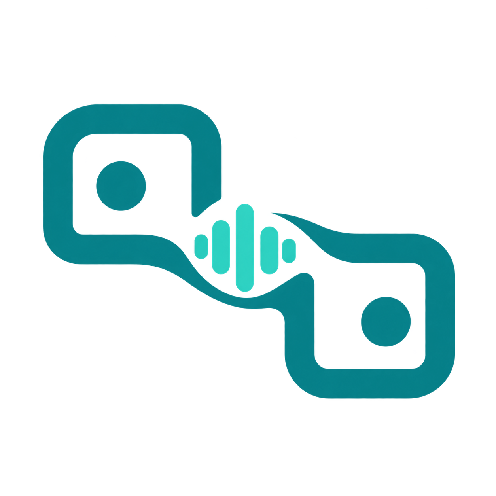
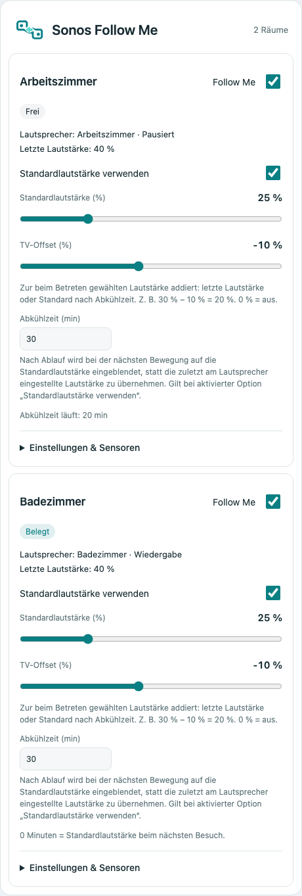

# Sonos Follow Me – deutsche Anleitung

<p></p>

Musik folgt dir durch mehrere Räume. Jeder Raum bekommt einen Sonos-Lautsprecher, mindestens zwei Sensoren, eigene Musikquellen und Zeitwerte. Die Einrichtung erfolgt vollständig in Home Assistant; zusätzliche `input_boolean`- oder `input_number`-Helfer sind nicht nötig.

## Installation

Voraussetzung: **Home Assistant 2026.9.0 oder neuer**, eingerichtete offizielle **Sonos-Integration** und mindestens zwei binäre Sensoren pro Raum.

1. In **HACS → Benutzerdefinierte Repositories** `https://github.com/mvs90/sonos-follow-me` als **Integration** hinzufügen.
2. **Sonos Follow Me** herunterladen und Home Assistant neu starten.
3. **Einstellungen → Geräte & Dienste → Integration hinzufügen → Sonos Follow Me** öffnen.
4. Raumname, Lautsprecher, primären Sensor, weitere Sensoren und Musikquellen auswählen.
5. Für jeden weiteren Raum erneut einen Eintrag hinzufügen. Einstellungen später über **Konfigurieren** ändern.

Das Repository ist über HACS als benutzerdefiniertes Repository installierbar. Es ist **nicht im HACS-Standardkatalog gelistet**. Die alte Blueprint-Automation für dieselben Lautsprecher deaktivieren, damit sie nicht gleichzeitig eingreift.

## Eigene Dashboard-Karte (ab v0.3.0)



*Vorschau mit simulierten Raumdaten.*

Die Karte wird im selben HACS-Paket mitgeliefert und automatisch geladen. Ab v0.3.1 zeigt sie das eigene Projektlogo im Kopfbereich; das Bild wird lokal mit der Integration ausgeliefert. Kein zweites HACS-Repository und keine manuelle Ressource sind nötig.

1. In HACS aktualisieren und Home Assistant neu starten.
2. Den Browser bzw. die Companion-App vollständig neu laden.
3. Dashboard bearbeiten → **Karte hinzufügen → Sonos Follow Me**.

Alternativ eine manuelle Karte anlegen:

```yaml
type: custom:sonos-follow-me-card
title: Sonos Follow Me
```

Ohne weitere Angaben erscheinen alle eingerichteten Räume. Im grafischen Karteneditor lassen sich Titel und einzelne Räume auswählen. Alternativ unter `entities` die Follow-Me-Schalter angeben (die tatsächlichen Entitäts-IDs aus deiner Installation verwenden):

```yaml
type: custom:sonos-follow-me-card
title: Musik im Haus
entities:
  - switch.badezimmer_follow_me
  - switch.arbeitszimmer_follow_me
```

Die Karte zeigt Belegung, Lautsprecher, gespeicherte Lautstärke, Sensorzustände, Quellenpriorität und eine laufende Abkühlzeit. Die Anzeige der verbleibenden Zeit aktualisiert sich etwa alle 30 Sekunden. **Follow Me**, **Standardlautstärke verwenden**, **Standardlautstärke in Prozent**, **Abkühlzeit**, **Ausschaltverzögerung**, **Überblenddauer** und **Sensorlogik** sind direkt bedienbar. Weitere Einstellungen sind pro Raum aufklappbar.

Ab v0.4.2 lassen sich Standardlautstärke und TV-Offset per Slider einstellen. Die Karte zeigt den TV-Offset als vorzeichenbehafteten Prozentwert; die Berechnung bleibt additiv (30 % − 10 % = 20 %). Der Hinweis an der Abkühlzeit erklärt, dass bei der nächsten Bewegung nach Ablauf wieder auf die Standardlautstärke eingeblendet wird, sofern die Rücksetzung aktiviert ist.

Die Bedienelemente sind normale Home-Assistant-Schalter, Zahlen- und Auswahlentitäten. Sie können auch in Standardkarten oder Automationen verwendet werden und unterliegen den normalen Entitätsberechtigungen. Änderungen bleiben gespeichert und laden die Raumsteuerung nicht neu; laufende Wiedergabekontrolle bleibt erhalten. Raumname sowie Sensor-, Lautsprecher- und Quellenzuordnung werden weiterhin unter **Konfigurieren** geändert; solche Änderungen laden den Raum neu.

Falls die Karte nach einem Update fehlt, zuerst Browser-/App-Cache neu laden. Als manueller Fallback kann unter Dashboard-Ressourcen `/sonos_follow_me/sonos-follow-me-card.js?v=0.4.3` als **JavaScript-Modul** eingetragen werden. Die Integration muss eingerichtet und geladen sein. Deaktivierte oder ausgeblendete Entitäten ggf. wieder aktivieren. Ein deaktivierter Raum-Eintrag ist keine steuerbare Karte.

## Integrationslogo und HACS-Anzeige (ab v0.3.2)

Das Projektlogo liegt zusätzlich unter `custom_components/sonos_follow_me/brand/` als Icon und Logo in normaler und hoher Auflösung. Home Assistant verwendet diese lokalen Bilder in seiner Integrationsoberfläche; nach dem HACS-Update Home Assistant neu starten und die Oberfläche neu laden.

**Die HACS-Repository-Liste ist ein separater Fall:** Dort besteht derzeit ein [offener Fehler für lokale Integrationslogos](https://github.com/hacs/integration/issues/5171). Die benötigten Bilder werden mitgeliefert, aber das Modul kann deren Anzeige in einer betroffenen HACS-Version nicht erzwingen. Ein Eintrag ins frühere zentrale Brands-Verzeichnis ist für neue Custom-Integrationen nicht mehr der vorgesehene Weg. Siehe [Home-Assistant-Dokumentation](https://developers.home-assistant.io/docs/core/integration/brand_images/).

## Sensorlogik

**Primär startet, weitere halten:** Der PIR muss zuerst Anwesenheit erkennen. Danach dürfen Radar und beliebig viele weitere Sensoren die Belegung halten. Ein Radar-Fehlalarm alleine startet keine Musik. Meldet ein Sensor bereits beim PIR-Ereignis Anwesenheit, hält er den Raum ebenfalls.

Beispiel Toilette: Der PIR erkennt das Betreten. Die Person sitzt still, der PIR meldet wieder „frei“, aber der Radar erkennt sie weiterhin. Die Musik bleibt an. Erst wenn **alle** Sensoren während der gesamten Ausschaltverzögerung „frei“ melden, endet die Belegung. Ein späterer Radar-Fehlalarm darf nicht neu starten.

**Alle Sensoren gleichberechtigt:** Jeder Sensor darf Anwesenheit starten und halten. Frei wird der Raum auch hier erst, wenn alle Sensoren durchgehend aus sind.

Nicht verfügbare oder unbekannte Sensoren gelten nicht als „frei“. Neue Anwesenheit während der Verzögerung oder beim Ausblenden bricht das Verlassen ab.

## Einstellungen und Bedienung

- **Ein Lautsprecher je Raum:** weitere Räume als weitere Einträge anlegen. Ein Sonos-Stereopaar kann als einzelne Sonos-Entität ausgewählt werden.
- **Mindestens zwei Sensoren:** ein primärer und mindestens ein weiterer; zusätzliche Sensoren sind möglich.
- **Musikquellen:** andere Sonos-Lautsprecher auswählen. Die erste spielende Quelle in der Auswahlreihenfolge gewinnt; es wird genau einer Gruppe beigetreten.
- **Ausschaltverzögerung:** 0–3600 Sekunden, Standard 15.
- **Überblenddauer:** 0–30 Sekunden, Standard 3. Mit 0 werden Überblendungen deaktiviert.
- **Anfangslautstärke:** 0–1, Standard 0,3. Danach wird die im normalen Betrieb geänderte Lautstärke gespeichert.
- Pro Raum entstehen ein **Follow-Me-Schalter** und ein **Belegungssensor**. Mehrere Schalter können gemeinsam über Dashboard oder Automation bedient werden.

## Optionale Standardlautstärke mit Abkühlzeit

Unter **Konfigurieren** gibt es drei neue Einstellungen:

- **Standardlautstärke nach Abwesenheit verwenden:** aktiviert die Funktion. Bei bestehenden und neuen Räumen zunächst ausgeschaltet.
- **Standardlautstärke (0–1):** beispielsweise 0,25 für 25 %.
- **Abkühlzeit:** in Minuten, beispielsweise 30. Mit **0** gilt die Standardlautstärke sofort für den nächsten Besuch, nachdem der Raum als frei erkannt wurde.

Die Zeit beginnt, sobald der Raum **nach der Ausschaltverzögerung** frei ist. Beispiel: letzte Lautstärke 60 %, Standard 25 %, Abkühlzeit 30 Minuten. Bei Rückkehr nach 10 Minuten wird wieder auf 60 % eingeblendet. Die alte Abkühlzeit wird verworfen; beim nächsten Verlassen starten erneut volle 30 Minuten. Bei Rückkehr nach mindestens 30 Minuten wird auf 25 % eingeblendet.

Die Funktion ändert die Ziel-Lautstärke beim nächsten Betreten. Während der Abwesenheit wird kein zusätzlicher Lautstärkebefehl gesendet; laufende Musik wird durch den Ablauf nicht verändert. Ein Radar-Fehlalarm alleine setzt die Abkühlzeit im PIR-Modus nicht zurück. Gültige Anwesenheit setzt sie auch dann zurück, wenn gerade keine Musikquelle spielt.

Eine begonnene Abkühlzeit übersteht Neustarts und Neuladen; die Zeit während des Neustarts zählt mit. Eine Änderung der Abkühlzeit verwendet die neue Dauer ab dem gespeicherten Zeitpunkt des Freiwerdens. Das Ausschalten von Follow Me startet selbst keine Abkühlzeit; ein vorhandener Zeitpunkt bleibt gespeichert. Die unten beschriebenen Grenzen der Wiedergabekontrolle nach Neustarts gelten weiterhin.

## TV-Ton und Lautstärkeoffset (ab v0.4.0)

Unter **Konfigurieren** und auf der Dashboard-Karte gibt es pro Raum **TV-Lautstärkeoffset / TV-Offset**. Ab v0.4.3 wird der Wert in **Prozentpunkten** auf die für diesen Besuch gewählte Lautstärke gerechnet. Die Karte zeigt den Offset als Prozentwert:

- Angepeilte Lautstärke 30 %, Offset **−10** → bei TV-Ton auf **20 %** einblenden.
- Angepeilte Lautstärke 30 %, Offset **+10** → bei TV-Ton auf **40 %** einblenden.
- **0** deaktiviert die TV-Anpassung und erhält das bisherige Verhalten.

Beim Beitritt wird der **Gruppenkoordinator** der gewählten Quelle geprüft. `source: TV` oder eine Sonos-TV-Stream-ID (`x-sonos-htastream:`) erkennt TV-Ton; der Medientitel, ein Soundbar-Modell oder `media_content_type: music` allein reichen nicht aus. Auch eine bereits gruppierte Box darf in der Quellenliste stehen: Entscheidend ist deren Koordinator.

Bei erkanntem TV-Ton und einem Offset ungleich 0 gilt **gewählte Ziellautstärke + Offset**, begrenzt auf 0–100 %. Ohne aktivierte Standardlautstärke oder bei Rückkehr vor Ablauf der Abkühlzeit ist die gespeicherte Lautstärke die Basis. Erst wenn die aktivierte Abkühlzeit abgelaufen ist, wird die Standardlautstärke zur Basis. Beispiel: letzte Lautstärke 40 %, Standard 25 %, Offset −10 % → vor Ablauf oder bei ausgeschalteter Rücksetzung 30 %, nach Ablauf 15 %. Für AirPlay, Musik und nicht erkannte Quellen entfällt der TV-Offset.

Während dieses TV-Besuchs manuell geänderte Lautstärken bleiben für den laufenden Besuch wirksam, überschreiben aber nicht die gespeicherte Musiklautstärke. Beim nächsten TV-Beitritt wird der Offset erneut auf die für den Besuch gewählte Basislautstärke angewendet; er summiert sich nicht über mehrere Besuche auf. Die Karte zeigt **TV-Lautstärke aktiv** mit dem Zielwert. Die Standardlautstärke und der Offset wirken auf den folgenden Beitritt; ein Quellenwechsel zwischen TV und Musik während einer bestehenden Gruppe löst keine automatische Lautstärkeänderung aus. Nach einem Neustart gilt weiterhin die unten beschriebene Rücksetzung der Wiedergabekontrolle.

## Stummer Start / Sonos Move (ab v0.4.1)

Beim Hinzufügen wartet Follow Me bis zu 10 Sekunden darauf, dass Home Assistant die richtige Gruppe und Wiedergabe am Raumlautsprecher meldet. Erst dann wird bei einem Zielwert über 0 dessen Mute aufgehoben und eingeblendet. Der Gruppenkoordinator und andere Lautsprecher werden nicht entstummt.

Nach dem Fade werden Lautstärke und Mute-Rückmeldung geprüft. Bleibt der Lautsprecher bei 0 oder stumm, folgen höchstens zwei weitere Einblendversuche mit jeweils bis zu 2 Sekunden für die Rückmeldung. Eine hörbare niedrigere Lautstärke wird dabei respektiert. Das ist eine begrenzte Startprüfung, kein dauerhaftes automatisches Entstummen. Ein absichtlich eingestellter Zielwert 0 bleibt stumm. Deaktivieren/Entladen bzw. eine abgelaufene Raumbelegung bricht den laufenden Start ab.

Eigene Lautstärkebefehle können verspätet gemeldet werden. Rückmeldungen, die einem eigenen Befehl der letzten 5 Sekunden entsprechen, werden deshalb nicht als neue manuelle Wunschlautstärke gespeichert. Echte manuelle Änderungen auf genau solche Werte können innerhalb dieses kurzen Fensters ebenfalls von der Speicherung ausgenommen sein; die Lautstärke am Gerät wird dadurch nicht zurückgesetzt.

Wiederholungen stehen im Home-Assistant-Protokoll unter `custom_components.sonos_follow_me`. Ein fehlgeschlagener Start erscheint zusätzlich als Attribut `startup_error` am Follow-Me-Schalter; beim nächsten Start wird es zurückgesetzt. Nach einem Fehler werden neue Beitrittsversuche für mindestens 30 Sekunden zurückgehalten. Bei erneuten Problemen sind `startup_error`, `volume_level`, `is_volume_muted` und `group_members` des betroffenen Lautsprechers hilfreich.

Die Fehlerfälle wurden mit verzögerten Gruppen-/Lautstärkerückmeldungen und gesetztem Mute simuliert und mit der alten Version reproduziert. Am 05.10.2026 bestand v0.4.1 zusätzlich neun Prüfungen an einem echten Move über Home Assistant 2026.9.4, darunter Start aus Stummschaltung, wiederholte Gruppenbeitritte und PIR/Radar-Verhalten. Zehn isolierte Fehlerszenarien wurden ebenfalls in dieser laufenden HA-Instanz erfolgreich geprüft. Die konkrete Ursache des ursprünglich sporadischen Gerätefehlers ist damit noch nicht bewiesen. Bereits früher gespeicherte Lautstärke 0 wird nicht automatisch durch einen höheren Wert ersetzt.

## Verhalten und Grenzen

Musik zunächst auf einer Quelle starten. Die Integration wählt keine Playlists und startet keine stumme Quelle. Sie übernimmt nur Lautsprecher, die sie selbst einer spielenden Gruppe hinzugefügt hat; bereits manuell laufende Musik und vorhandene Gruppen werden nicht übernommen. Beim Verlassen blendet sie aus, trennt den verwalteten Lautsprecher ab, pausiert ihn und stellt die gespeicherte Lautstärke wieder her. Wird er zwischenzeitlich Gruppenkoordinator für andere Lautsprecher, gibt die Integration die Kontrolle ab, statt die Gruppe zu zerlegen.

Ausschalten des Follow-Me-Schalters lässt die aktuelle Wiedergabe bestehen. Lautstärke und Schalterzustand bleiben über Neustarts erhalten. Belegung und Wiedergabekontrolle werden beim Neustart oder Neuladen zurückgesetzt. Änderungen der öffentlichen Einstellungen laden den Raum ab v0.3.0 nicht mehr neu. Eine zuvor verbundene Wiedergabe wird dann nicht automatisch gestoppt; den Raum einmal manuell abtrennen/pausieren, um ihn beim nächsten Betreten wieder automatisch übernehmen zu lassen.

Lautstärkeänderungen **während einer Überblendung** werden nicht gespeichert und können überschrieben werden. Für unmittelbare manuelle Kontrolle die Überblenddauer auf 0 setzen. Netzwerkfehler können Sonos-Aktionen verhindern; Fehler stehen im Home-Assistant-Protokoll. Nach der Fehlersperre kann ein späteres Zustandsereignis einen neuen Beitrittsversuch auslösen.

Software- und Praxistests laufen gegen **Home Assistant 2026.9.4**. Das [Testlabor](dev/README.md) beschreibt die Docker-Netzwerkanbindung, wiederholbare Fehlersimulationen und den optionalen Testlauf am echten Move. Zugangsdaten, Sicherungen und detaillierte lokale Testberichte bleiben im von Git ausgeschlossenen Verzeichnis `.local/`. Veröffentlichung und Installation konfigurieren deine laufende Home-Assistant-Instanz nicht automatisch.

MIT-Lizenz, unabhängiges Community-Projekt. Weitere technische Hinweise und Entwicklungsbefehle stehen in der [englischen README](README.md).
